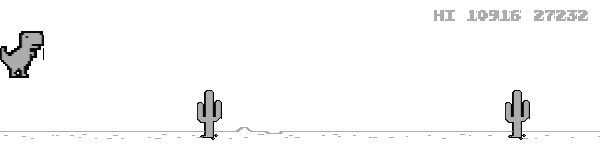
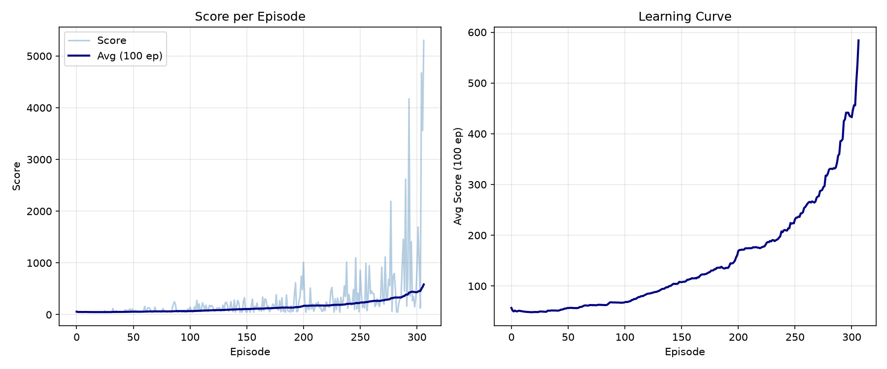

# DQN T-Rex Runner

A Deep Q-Network trained to play the Chrome dinosaur game using only pixels from the browser.



*A highlight, not a typical game: the last 30 seconds of the best episode out of the episodes that were run, at 20 frames per second (one frame per agent step). The statistics below describe typical performance.*

## Results

Training ran for 307 episodes and 154,484 environment steps (one run, seed 42 for Python, NumPy and PyTorch). The browser's obstacle spawning is not seeded, so runs are not exactly reproducible. Training stopped because the step budget was reached, not because the curve flattened: the learning curve was still rising.



**Score.** Scores are the game's own distance-based score. The agent's training reward is different: +0.1 per step survived and -1.0 on a crash. In the training logs the score grows by about 0.54 points per agent step, so 5,000 points is roughly 9,000 steps, about 8 minutes of game time.

**Early training:** in the first 50 training episodes the mean score was 57 (median 47). Scores of 46-47 were very common.

**Evaluation during training:** every 100 episodes (configurable with `--eval-every`), plus at the training step limit and final episode, the agent plays a few episodes with no exploration (3 by default, see `config.py`). These evaluations were noisy: the mean score was 1214, 859, 306 and finally 2829. The final evaluation was the best, so `best_model.pth` is the final policy.

**Final test** (`python play.py --episodes 20` on `best_model.pth`):

- Scores: 177, 21377, 1130, 46, 16199, 7110, 1444, 2191, 2707, 612, 6321, 923, 4251, 1482, 5696, 1815, 3166, 11952, 3159, 388
- Median 2449, mean 4607, standard deviation 5573 (population), min 46, max 21377
- 30% of games reached 5,000 or more, and 15% ended below 500
- The distribution is very spread out and 20 episodes give a wide uncertainty, so treat these numbers as rough

## How It Works

**Game.** Loaded from https://elvisyjlin.github.io/t-rex-runner/ (a third-party implementation of Chromium's T-Rex runner) and driven with Selenium and Chrome. 

**Environment.**

- Game speed is fixed (acceleration disabled) and clouds are removed.
- 2 actions: do nothing (0) and jump (1). Duck is not used because only cacti appear at the fixed speed.
- The game is paused between agent steps. Each step resumes it, applies the action, lets it run for about 0.05 s of game time (20 decisions per second), pauses it again and then captures the frame. Browser timing adds some jitter, so the actual progress per step varies slightly.
- Resuming the game resets the dino's animation state, which slows jumps down; the environment saves and restores that state around each resume.
- Because the game is paused while the agent thinks, the agent does not play under human real-time conditions. Its scores should not be compared with human scores.

**Agent.** Vanilla DQN (no Double or Dueling variants), MSE loss, no gradient clipping.

- Input: 4 stacked 80×20 grayscale frames (keeps the 4:1 aspect ratio of the 600×150 canvas)
- Network: 3 convolutional layers (32, 64, 64 filters; kernels 4×4, 3×3, 3×3) followed by fully connected layers of 512 and 2 units
- Reward: +0.1 per step survived, -1.0 on a crash
- Replay buffer: 50,000 transitions, batch size 16
- Target network: hard update every 1,000 steps
- Exploration: epsilon-greedy, linear decay from 0.1 to 0.0001 over 100,000 steps
- Gamma 0.99, Adam optimizer with learning rate 1e-4
- The first 100 steps are collected before any weight updates

## Setup and Usage

**Requirements:**
- Python 3.11 or higher
- Google Chrome browser
- NVIDIA GPU with CUDA support (recommended; CPU training is much slower)

**Installation:**

1. Install PyTorch with CUDA support first (visit [https://pytorch.org/get-started/locally/](https://pytorch.org/get-started/locally/) for your system):
```bash
# Example for CUDA 12.6:
pip install torch --index-url https://download.pytorch.org/whl/cu126
```

2. Install remaining dependencies:
```bash
pip install -r requirements.txt
```

Note: Selenium automatically downloads the matching ChromeDriver.

**Training:**

Train from scratch (see `python train.py --help` for options):
```bash
python train.py
```

Training stops once 150,000 environment steps are reached (after the current episode finishes), and a single training episode is capped at 10,000 steps. It writes `logs/training_log.csv`, `logs/eval_log.csv` and `logs/training_plot.png`, plus `best_model.pth`, `last_model.pth` and TensorBoard logs in `logs/tensorboard/` (view with `tensorboard --logdir logs/tensorboard`).

Play the trained model:

```bash
python play.py --episodes 20
python play.py --episodes 10 --save-gif
```

`--save-gif` writes `logs/best_run.gif`, the last 30 seconds of the best episode. `play.py` has no step cap, so a single very good episode can take a long time.

## Project Structure

```
agent.py           DQN network and agent implementation
config.py          Hyperparameters and configuration
game_env.py        Selenium-based T-Rex game environment
train.py           Training loop with evaluation
play.py            Inference and optional GIF recording
best_model.pth     Trained model best weights
last_model.pth     Trained model last weights
requirements.txt   Python dependencies
logs/
  training_log.csv   Per-episode training metrics
  eval_log.csv       Evaluation results during training
  training_plot.png  Learning curve visualization
  best_run.gif       Demo recording
  tensorboard/       TensorBoard logs
```

## Limitations

- One training run and one reported model, with no hyperparameter tuning; results from other runs could differ a lot.
- Training had not converged when the step budget ended.
- Evaluation during training used few episodes and was noisy; the 20-episode final test is also small.
- Scores are very spread out (some games end early, a few last very long).
- The environment pauses the game between steps, so results are not comparable with real-time play or with human scores.
- Depends on a third-party web page and on Chrome.

## Credits and License

This project is released under the MIT License (see LICENSE file).

The T-Rex game is a third-party implementation hosted at https://elvisyjlin.github.io/t-rex-runner/. It is not part of this repository, and its license and ownership belong to its creators.